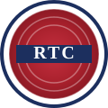
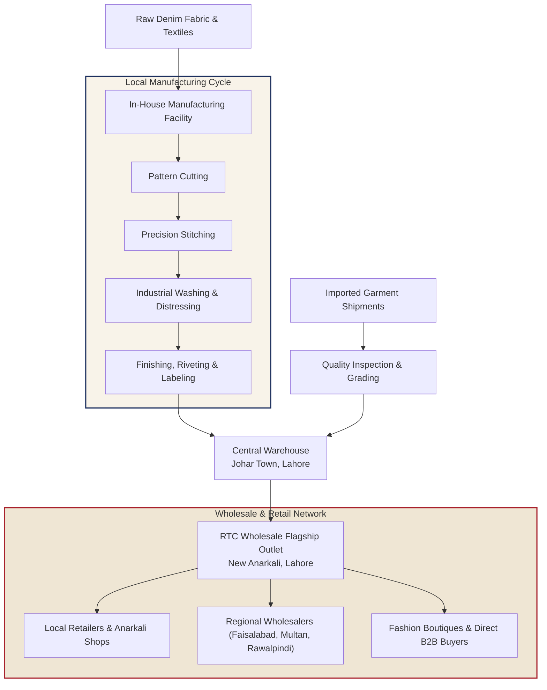

<div align="center">

  

  # Rafique Trading Company (RTC)
  ### *Importer & Manufacturer of Quality Garments — Lahore, Pakistan*

  [](#)
  [](#)
  [](#)
  [](#)
  [](#)

  <p align="center">
    <strong>A high-performance, responsive multi-page web platform showcasing 15+ years of apparel manufacturing, denim production, importing, and wholesale operations.</strong>
  </p>

  <p align="center">
    <a href="#-quick-tour--page-breakdown">Explore Pages</a> &bull;
    <a href="#-business-workflow">Operational Workflow</a> &bull;
    <a href="#-quick-start--local-development">Run Locally</a> &bull;
    <a href="#-formspree-contact-setup">Contact Setup</a> &bull;
    <a href="#-business-directory--contact">Get in Touch</a>
  </p>

</div>

---

## 📑 Interactive Table of Contents

- [🏢 About Rafique Trading Company](#-about-rafique-trading-company)
- [✨ Key Features](#-key-features)
- [🔄 Business Workflow](#-business-workflow)
- [📁 Interactive Repository Structure](#-interactive-repository-structure)
- [🌐 Quick Tour & Page Breakdown](#-quick-tour--page-breakdown)
- [🎨 Design System & Color Tokens](#-design-system--color-tokens)
- [🚀 Quick Start & Local Development](#-quick-start--local-development)
- [📨 Formspree Contact Setup](#-formspree-contact-setup)
- [✅ Quality & Launch Checklist](#-quality--launch-checklist)
- [📍 Business Directory & Contact](#-business-directory--contact)

---

## 🏢 About Rafique Trading Company

Established for over **15 years** in Lahore, Pakistan, **Rafique Trading Company (RTC)** is an official **Chamber of Commerce Registered** and **active NTN taxpayer** garment business. 

RTC manages the complete lifecycle of quality apparel:
1. **Garment Importing:** Sourcing curated collections from verified international manufacturers to bring variety and margin advantages to wholesale clients.
2. **Local Manufacturing:** In-house production from cutting, stitching, denim washing, to finished packaging — with special focus on men's & women's jeans.
3. **Wholesale Distribution:** Direct B2B sales to shopkeepers, retailers, and boutique owners from its flagship outlet in **New Anarkali, Lahore**, backed by storage in **Johar Town**.

---

## ✨ Key Features

- **⚡ Zero External Dependencies:** Built with pure vanilla HTML5, semantic CSS3, and standard ES6 JavaScript — ultra-fast load times and zero build steps required.
- **📱 Fully Responsive Layout:** Mobile-first architecture with collapsible hamburger navigation, adaptive grids (`1fr`, `2fr`, `3fr`), and fluid typography.
- **👔 Classic Tailored Aesthetics:** Warm heritage color palette with Playfair Display typography, subtle hover transitions, and clean cards.
- **🗺️ Real-world Integration:** Embedded Google Maps for physical retail location and accessible tap-to-call / click-to-email communication triggers.
- **📬 Built-in Contact Processing:** Formspree-ready contact form complete with client-side guardrails and configuration indicators.
- **♿ Accessible & SEO-Optimized:** Semantic landmarks (`<header>`, `<nav>`, `<section>`, `<footer`), Open Graph tags, descriptive meta descriptions, and accessible ARIA attributes.

---

## 🔄 Business Workflow

The diagram below illustrates RTC's end-to-end supply chain and wholesale operations:



---

## 📁 Interactive Repository Structure

Click below to expand and explore the codebase layout:

<details open>
<summary><b>📂 Click to collapse / expand file tree</b></summary>

```text
Rafique-Trading-Company/
├── index.html                  # Homepage (Hero, Trust metrics, Core pillars, Testimonials, CTA)
├── about.html                  # Company background, 15+ year heritage, operational model
├── services.html               # 6 core service modules & step-by-step production process
├── portfolio.html              # Product showcase (Denim, Imported casual wear, In-house line)
├── testimonials.html           # Verified reviews from regional retailers and wholesale buyers
├── contact.html                # Inquiry form, New Anarkali Google Map embed, facility addresses
│
├── css/
│   └── style.css               # Unified stylesheet: CSS custom properties, grid system, responsive styles
│
├── js/
│   └── script.js               # Mobile navigation toggle, current page highlighter, form handler, year helper
│
└── assets/
    ├── logo.svg                # Scalable vector logo badge with RTC emblem
    └── gallery/                # High-resolution photographic assets
        ├── boutique-rack.jpg   # Imported casual wear rack display
        ├── clothes-hero.jpg    # Banner hero backdrop
        ├── clothing-choice.jpg # Assorted ready-made garment selection
        ├── factory-sewing.jpg  # Garment stitching & industrial sewing line
        ├── factory-workers.jpg # Manufacturing team on the factory floor
        ├── folded-jeans.jpg    # Stacked denim jeans with quality tags
        ├── jeans-label.jpg     # Denim branding & detail view
        ├── jeans-stack.jpg     # Premium folded wholesale denim trousers
        └── store-interior.jpg  # Wholesale showroom and retail storage
```

</details>

---

## 🌐 Quick Tour & Page Breakdown

<details open>
<summary><b>🔍 Click to view page-by-page details</b></summary>

| Page | File | Purpose & Highlights |
| :--- | :--- | :--- |
| **Home** | [`index.html`](index.html) | Brand introduction, trust badges (Chamber of Commerce & NTN), key metrics (15+ Years, 2 Facilities, 100% Compliant), and prominent CTAs. |
| **About Us** | [`about.html`](about.html) | RTC's origin story, evolution from trading to full manufacturing, 3-step operational framework, and production photos. |
| **Services** | [`services.html`](services.html) | Six detailed service cards: Importing, Local Manufacturing, Jeans Production, Wholesale Distribution, Bulk/B2B Orders, and Compliance. |
| **Portfolio** | [`portfolio.html`](portfolio.html) | Responsive photo gallery exhibiting jeans stacks, casual wear, factory floor machines, and retail stock. |
| **Testimonials** | [`testimonials.html`](testimonials.html) | Verified 5-star testimonials from buyers across Lahore, Anarkali, Multan, Faisalabad, and Karachi. |
| **Contact** | [`contact.html`](contact.html) | Dual facility info (Anarkali Outlet + Johar Town Warehouse), interactive Google Map, direct phone/email triggers, and B2B inquiry form. |

</details>

---

## 🎨 Design System & Color Tokens

The visual identity is governed by custom CSS variables configured in [`css/style.css`](css/style.css):

```css
:root {
  --color-bg: #f8f3e9;        /* Warm Cream Canvas */
  --color-bg-alt: #efe6d4;    /* Sand Stone Accent */
  --color-panel: #ffffff;     /* Card & Panel White */
  --color-dark: #221d1a;      /* Charcoal Body Dark */
  --color-navy: #1c2f5e;      /* Heritage Navy (Trust & Badging) */
  --color-red: #a8202c;       /* Crimson Brand Accent */
  --color-gold: #d98a34;      /* Amber / Antique Gold */
  --color-gold-dark: #b56a1e; /* Deep Antique Gold */
  --color-text: #2b2420;      /* High Contrast Text */
  --color-muted: #6b6259;     /* Secondary Sub-text */
  --color-border: #e2d7c1;    /* Subtle Dividing Lines */
  --radius: 10px;             /* Standard Border Radius */
  --max-width: 1160px;        /* Central Grid Container */
}
```

### Typography Hierarchy
- **Display Headings (`h1`, `h2`, `h3`, `h4`, `.logo-word`):** `'Playfair Display', Georgia, serif`
- **Body & UI Controls:** `'Inter', -apple-system, BlinkMacSystemFont, 'Segoe UI', sans-serif`

---

## 🚀 Quick Start & Local Development

Because this project is built with standard web technologies without external dependencies, you can run and preview it instantly using any of the methods below:

<details open>
<summary><b>🛠️ Choose your preferred preview method</b></summary>

### Method 1: VS Code Live Server (Easiest)
1. Open this directory in **Visual Studio Code**.
2. Install the **Live Server** extension (`ritwickdey.liveserver`).
3. Right-click [`index.html`](index.html) and click **"Open with Live Server"**.

### Method 2: Python HTTP Server (Built-in)
Run in your terminal from the root folder:

```bash
# Python 3
python -m http.server 8080
```
Open [`http://localhost:8080`](http://localhost:8080) in your browser.

### Method 3: Node.js `npx serve`
```bash
npx serve .
```

### Method 4: Direct Browser Preview
Double-click [`index.html`](index.html) or open it directly in Google Chrome, Microsoft Edge, or Mozilla Firefox.

</details>

---

## 📨 Formspree Contact Setup

The contact form on [`contact.html`](contact.html#L95) is pre-configured for [Formspree](https://formspree.io) to deliver inquiries straight to RTC's inbox.

<details>
<summary><b>⚙️ Step-by-Step Activation Instructions</b></summary>

1. Register or log in at **[formspree.io](https://formspree.io)**.
2. Click **"+ New Form"** and set the submission notification target (e.g. `info@rafiquetradingcompany.com`).
3. Copy your Form ID (e.g., `xyzabkpq`).
4. Open [`contact.html`](contact.html) and locate line 95:
   ```html
   <!-- Change YOUR_FORM_ID to your actual Formspree endpoint -->
   <form class="contact-form" action="https://formspree.io/f/YOUR_FORM_ID" method="POST">
   ```
5. Replace `YOUR_FORM_ID` with your Formspree ID:
   ```html
   <form class="contact-form" action="https://formspree.io/f/xyzabkpq" method="POST">
   ```
6. Remove or hide the helper notice in [`contact.html`](contact.html) (lines 92–94).

> **Note:** Until configured, [`js/script.js`](js/script.js) intercepts form submissions containing `YOUR_FORM_ID` and displays a friendly reminder prompt without throwing uncaught errors.

</details>

---

## ✅ Quality & Launch Checklist

Interactive roadmap tracking the repository status:

- [x] Responsive layout tested across Mobile, Tablet, and Desktop resolutions
- [x] Cross-page navigation highlighting active tab automatically
- [x] Dynamic copyright year injection via JavaScript
- [x] Accessible navigation toggle with ARIA expanded states
- [x] Fast load times with local optimized JPEG photography
- [x] Vector SVG logo with crisp scaling at all resolutions
- [ ] Connect production Formspree endpoint ID
- [ ] Connect custom domain (e.g., `rafiquetradingcompany.com`)
- [ ] Add direct WhatsApp chat trigger for mobile wholesale buyers

---

## 📍 Business Directory & Contact

<div align="center">

| Location | Address | Coordinates / Map |
| :--- | :--- | :--- |
| **Wholesale Outlet & Office** | 34-35, Khalid Centre, Khan Plaza, New Anarkali, Lahore, Pakistan | [View on Google Maps](https://maps.google.com/?q=34-35+Khalid+Centre+Khan+Plaza+New+Anarkali+Lahore+Pakistan) |
| **Central Warehouse** | 50-B, BOR Society, Johar Town, Lahore, Pakistan | Johar Town Logistics Hub |

<br>

<a href="tel:+923210998999">
  
</a>
&nbsp;
<a href="mailto:info@rafiquetradingcompany.com">
  
</a>

<p style="margin-top: 15px; font-size: 0.9rem; color: #6b6259;">
  &copy; <span id="rtc-year">2026</span> Rafique Trading Company. All Rights Reserved. Chamber of Commerce & NTN Registered.
</p>

</div>
